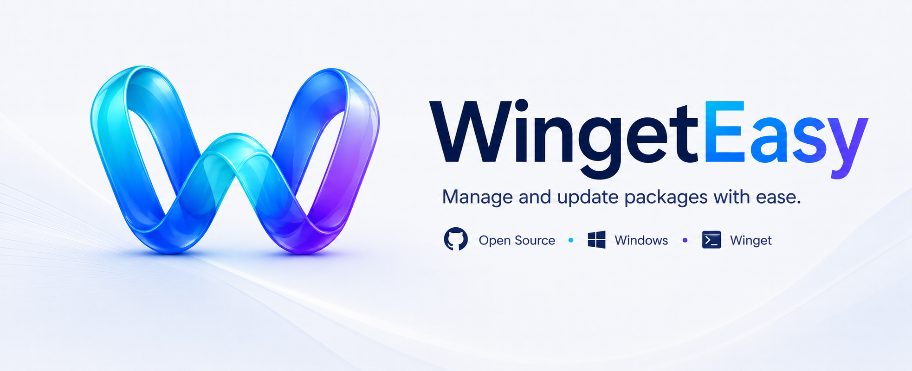

<div align="center">
  

# WingetEasy

**A visual interface for Winget, built with WinUI 3**

[](https://github.com/WingetEasy/WingetEasy/actions/workflows/ci.yml)
[](LICENSE)
[](https://dotnet.microsoft.com/)
[](https://microsoft.com/windows)

WingetEasy is an open source, modern, and ultra-lightweight desktop application providing an intuitive graphical interface for Winget, the native Windows package manager.

[Contributing](CONTRIBUTING.md) • [Roadmap](ROADMAP.md) • [Discussions](https://github.com/WingetEasy/WingetEasy/discussions) • [License](LICENSE)

**🌍 Read this in other languages:** [Português (BR)](README.pt-BR.MD)

</div>

---

## Table of Contents

- [Overview](#overview)
- [Why WingetEasy](#why-wingeteasy)
- [Features](#features)
- [Current State](#current-state)
- [Repository Structure](#repository-structure)
- [Requirements](#requirements)
- [Getting Started](#getting-started)
- [Packages and Stack](#packages-and-stack)
- [Headless CLI Mode](#headless-cli-mode)
- [Roadmap Status](#roadmap-status)
- [How to Contribute](#how-to-contribute)
- [Contributors](#contributors)
- [License](#license)

---

## Overview

**WingetEasy** is built on **.NET 10**, **C# 14**, and **WinUI 3 (Windows App SDK)**, following a clean and modular architecture:

- `WingetEasy.App`: Desktop presentation layer with Fluent Design, system tray integration, custom controls, and native toast notifications.
- `WingetEasy.Core`: Business logic, update orchestrator, Winget CLI parser, Windows Task Scheduler integration, and headless runner.
- `WingetEasy.Data`: Persistence powered by Entity Framework Core with SQLite, automatic migrations, and ephemeral db contexts via `IDbContextFactory`.

The primary objective is to grant **full control to the user** over software updates while keeping resource consumption near zero.

---

## Why WingetEasy

While mature tools exist that support multiple package ecosystems and extensive feature sets, WingetEasy is crafted with a laser-focused philosophy: **to be the most unobtrusive, reliable, and resource-efficient updater possible**.

- **Minimal RAM Footprint:** Highly optimized memory footprint hovering between **7 MB and 70 MB** (releasing UI DirectX buffers and calling `EmptyWorkingSet` when hidden to the tray).
- **No Surprises:** You are always in control. Nothing is installed or updated without your explicit consent.
- **Quiet by Default:** Minimal, actionable notifications with Quiet Hours support (suppressed between 10 PM and 8 AM).
- **Resilient & Self-Healing:** Pre-flight detection of in-use processes, automated UAC fallback, and one-click Winget source repair (`winget source reset`).

| Criteria | WingetEasy | UniGetUI |
| --- | --- | --- |
| **Philosophy** | Discreet, lightweight, focused updater | Comprehensive multi-manager package suite |
| **RAM Usage** | **7 MB – 70 MB** (first-class engineering goal) | Typically higher (150 MB+) |
| **Update Execution** | Always requires explicit user confirmation | Broad automation options |
| **Notifications** | Minimal, non-intrusive, customizable | More present and frequent |
| **Scope** | Native Windows Winget integration | Multi-ecosystem (pip, npm, scoop, etc.) |

---

## Features

- ⚡ **Instant Update Detection:** Displays newly available package versions in real time with semantic badges and automatic categorization (Apps, Runtimes, Security).
- 📊 **Granular Progress:** Step-by-step visual indicators per package (`Pending`, `Updating` with progress ring, `Completed`, `Failed`) with comprehensive post-update summary dialogs.
- 🕒 **Comprehensive History:** Chronological timeline grouped by date with from/to versions, search filtering, and SQLite persistence.
- 💾 **Backup & Restore Snapshots:** Export installed packages snapshot via Winget and effortlessly recreate your setup on a fresh machine.
- 📁 **Software Profiles:** Curate custom package bundles (e.g., *Development*, *Productivity*, *Design*) for batch installation with a single click.
- ⚙️ **Native Windows Scheduling:** Integrated with the **Windows Task Scheduler** for seamless background checks, in addition to an in-app `PeriodicTimer`.
- 💻 **Headless CLI Runner:** Run check and update routines through PowerShell scripts or terminal commands without spawning the GUI.
- 🔄 **Velopack Auto-Updates:** Background delta downloads and silent auto-updates for the WingetEasy application itself.
- 🔔 **Smart System Tray:** Status-aware tray icon with dynamic tooltips, quick actions menu, and compact flyout launcher.
- 🎨 **Fluent Design & Live Theming:** Seamless support for Light, Dark, and System themes powered by Mica and Acrylic materials.
- 🛠️ **Winget Self-Healing:** Built-in maintenance card to automatically reset and repair corrupted Winget sources without requiring manual terminal commands.

---

## Current State

- ✅ **Milestone 1 — Core without UI (100%):** Immutable domain models, EF Core SQLite layer, `WingetService`, `UpdateService`, `AdminElevationHelper`, and comprehensive xUnit test suite.
- ✅ **Milestone 2 — WinUI 3 Base UI (100%):** Mica window shell, `NavigationView`, `SettingsPage`, and `PackageItemControl`.
- ✅ **Milestone 3 — Polish & Real Services (100%):** ViewModels fully connected to live services, update history timeline, native toast notifications, guided onboarding dialog, and real-time theme synchronization.
- ✅ **Milestone 4 — Advanced Features (100%):** Backup/Restore snapshots, package profiles, category filters, headless CLI runner, Velopack updater, and native Windows Task Scheduler support.
- ✅ **Milestone 5 — Visual Polish & Memory Optimization (100%):** Full icon sets, splash screen, design tokens, dramatic RAM optimization (7 MB to 70 MB), and Winget source auto-healing.
- 🔄 **Milestone 6 — Distribution (In Preparation):** MSIX release packaging, code signing, CI release pipeline, and official `microsoft/winget-pkgs` submission.

---

## Repository Structure

```text
WingetEasy/
├── src/
│   ├── WingetEasy.App/             # WinUI 3 desktop client (Views, ViewModels, Pages, Tray, Assets)
│   ├── WingetEasy.Core/            # Domain models, parsing logic, CLI runner, scheduler, and update orchestrator
│   └── WingetEasy.Data/            # EF Core SQLite context, entities, repositories, and migrations
├── tests/
│   └── WingetEasy.Core.Tests/      # Unit tests using xUnit, Moq, and FluentAssertions
├── doc/
│   └── images/                     # Documentation banners and screenshots
├── Documents/                      # Planning, architecture history, and issue specifications
├── CONTRIBUTING.md                 # Contribution guidelines, commit rules, and coding standards
├── ROADMAP.md                      # Detailed roadmap and milestone checklist
└── README.MD                       # Main project documentation in English
```

---

## Requirements

To build and run the solution locally:

- **Operating System:** Windows 10 (Build 19041+) or Windows 11.
- **Development Environment:** Visual Studio 2022 (v17.8+) with workloads:
  - *.NET Desktop Development*
  - *Windows App SDK Development*
- **SDK:** .NET 10 SDK.
- **Git** for version control.

---

## Getting Started

1. Open `WingetEasy.slnx` in Visual Studio.
2. Allow NuGet packages to restore automatically via `Directory.Packages.props`.
3. Set `WingetEasy.App` as the Startup Project.
4. Press **F5** to build and run.

The application starts with a Mica background and system tray integration. Keyboard accelerators (`F5` to refresh, `Ctrl+F` to search) are active right out of the box.

---

## Packages and Stack

- **UI Framework:** WinUI 3, Windows App SDK.
- **MVVM Toolkit:** `CommunityToolkit.Mvvm`.
- **System Tray:** `H.NotifyIcon.WinUI`.
- **Database & ORM:** Entity Framework Core with SQLite provider (`Microsoft.EntityFrameworkCore.Sqlite`).
- **Dependency Injection & CLI:** `Microsoft.Extensions.DependencyInjection` and `System.CommandLine`.
- **Background Scheduling:** `Microsoft.Win32.TaskScheduler`.
- **Auto-Update Engine:** `Velopack`.
- **Structured Logging:** Serilog (File and Debug sinks).
- **Unit Testing:** xUnit, Moq, and FluentAssertions.

---

## Headless CLI Mode

WingetEasy supports command-line execution for scripts and automated task runners:

```bash
# Check for available updates silently
WingetEasy.App.exe --check

# Upgrade all pending packages in the background
WingetEasy.App.exe --update-all

# Launch the app directly minimized to the system tray
WingetEasy.App.exe --minimized
```

---

## Roadmap Status

| Phase | Scope | Status |
|---|---|:---:|
| **Milestone 1 — Core without UI** | Domain services, parsing, and EF Core | ✅ Completed |
| **Milestone 2 — Base WinUI 3** | Fluent shell, pages, and navigation | ✅ Completed |
| **Milestone 3 — Polish & Robustness** | Real service integration, Toasts, and Onboarding | ✅ Completed |
| **Milestone 4 — Advanced Features** | Backup, Profiles, CLI, Velopack, and Task Scheduler | ✅ Completed |
| **Milestone 5 — Visual Identity** | Design tokens, theming, and source auto-healing | ✅ Completed |
| **Milestone 6 — Distribution** | Packaging, release pipelines, and `winget-pkgs` | 🔄 In Preparation |

For a complete breakdown of each issue, check out [ROADMAP.md](ROADMAP.md).

---

## How to Contribute

1. Read [CONTRIBUTING.md](CONTRIBUTING.md) for conventions, architecture guidelines, and branching strategy.
2. Check [ROADMAP.md](ROADMAP.md) or open [Issues](https://github.com/WingetEasy/WingetEasy/issues) for available tasks.
3. Create your feature branch: `git checkout -b feature/your-feature` or `git checkout -b fix/your-fix`.
4. Ensure all unit tests pass: `dotnet test`.
5. Submit a Pull Request referencing the related issue following our [PR template](pull_request_template.md).

By participating, you agree to adhere to our [Code of Conduct](CODE_OF_CONDUCT.md).

---

## Contributors

[](https://github.com/WingetEasy/WingetEasy/graphs/contributors)

A warm thank you to everyone contributing code, issues, and ideas to make WingetEasy the cleanest update experience on Windows.

---

## License

This project is licensed under the [GPL-3.0 License](LICENSE).
