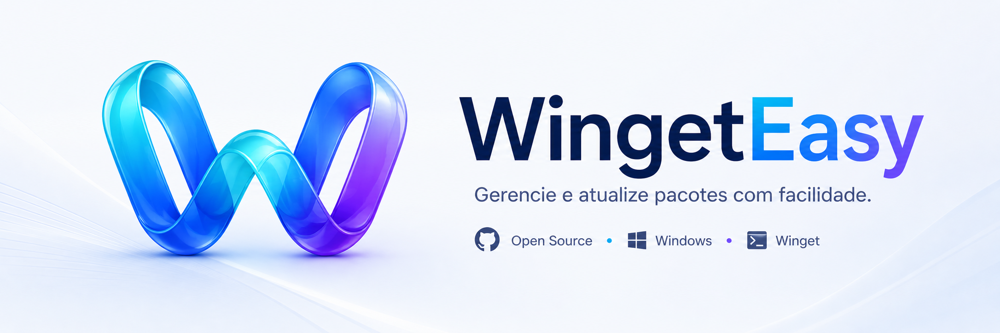

<div align="center">
  

# WingetEasy

**Interface visual para o Winget, feita com WinUI 3**

[](https://github.com/WingetEasy/WingetEasy/actions/workflows/ci.yml)
[](LICENSE)
[](https://dotnet.microsoft.com/)
[](https://microsoft.com/windows)

O WingetEasy é um aplicativo desktop open source moderno e ultraleve que traz uma interface gráfica fluida e inteligente para o Winget, o gerenciador de pacotes nativo do Windows.

[Contribuindo](CONTRIBUTING.md) • [Roadmap](ROADMAP.md) • [Discussions](https://github.com/WingetEasy/WingetEasy/discussions) • [Licença](LICENSE)

**🌍 Leia em outros idiomas:** [English](README.MD)

</div>

---

## Sumário

- [Visão Geral](#visão-geral)
- [Por Que WingetEasy](#por-que-wingeteasy)
- [Funcionalidades](#funcionalidades)
- [Estado Atual](#estado-atual)
- [Estrutura do Repositório](#estrutura-do-repositório)
- [Requisitos](#requisitos)
- [Como Executar](#como-executar)
- [Pacotes e Stack](#pacotes-e-stack)
- [Modo CLI (Headless)](#modo-cli-headless)
- [Status do Roadmap](#status-do-roadmap)
- [Como Contribuir](#como-contribuir)
- [Contribuidores](#contribuidores)
- [Licença](#licença)

---

## Visão Geral

O **WingetEasy** é construído com **.NET 10**, **C# 14** e **WinUI 3 (Windows App SDK)**, estruturado em uma arquitetura limpa e modular:

- `WingetEasy.App`: Interface visual moderna com Fluent Design, ícone na bandeja do sistema, controles personalizados e notificações nativas.
- `WingetEasy.Core`: Serviços de domínio, orquestração de atualizações, parser do Winget CLI, integrações com agendamento do Windows e execução headless.
- `WingetEasy.Data`: Persistência com Entity Framework Core e SQLite, migrations automáticas e repositórios otimizados com ciclos de vida efêmeros (`IDbContextFactory`).

O propósito central é proporcionar **total controle ao usuário** sobre as atualizações do sistema de forma rápida, segura e com consumo quase imperceptível de recursos.

---

## Por Que WingetEasy

Enquanto outros gerenciadores buscam cobrir múltiplos ecossistemas e dezenas de funcionalidades pesadas, o WingetEasy foi concebido com uma filosofia clara: **ser o utilitário mais discreto, confiável e eficiente possível**.

- **Consumo mínimo de RAM:** Arquitetura otimizada que consome entre **7 MB e 70 MB** (descarregando caches de UI e ativando `EmptyWorkingSet` ao minimizar para a bandeja).
- **Sem surpresas:** Nenhuma atualização ocorre sem a sua confirmação explícita.
- **Silencioso por padrão:** Notificações e alertas pontuais, com suporte a Horário de Silêncio (*Quiet Hours*).
- **Resiliente e Auto-curável:** Detecta processos em uso antes de atualizar, trata elevações administrativas (UAC) e oferece recuperação com um clique das fontes do Winget (`winget source reset`).

| Critério | WingetEasy | UniGetUI |
| --- | --- | --- |
| **Filosofia** | Atualizador discreto, ultraleve e focado | Gerenciador multigerenciador amplo |
| **Uso de RAM** | **7 MB – 70 MB** (prioridade de engenharia) | Tipicamente maior (150 MB+) |
| **Automação** | Decisão sempre consciente do usuário | Automações abrangentes |
| **Notificações** | Mínimas, configuráveis e não intrusivas | Mais presentes e frequentes |
| **Escopo** | Foco cirúrgico no Winget oficial do Windows | Suporte a múltiplos gerenciadores (pip, npm, etc.) |

---

## Funcionalidades

- ⚡ **Verificação e Atualização Rápida:** Lista em tempo real os pacotes que possuem atualizações disponíveis, com badges semânticos e categorização inteligente (Apps, Runtimes, etc.).
- 📊 **Progresso Granular:** Acompanhe o status por pacote (`Aguardando`, `Atualizando` com anel de progresso, `Concluído` ou `Falha`) e resumo detalhado ao término.
- 🕒 **Histórico Completo:** Timeline de atualizações anteriores agrupada por data, com versões de origem e destino, busca e persistência no SQLite.
- 💾 **Backup & Restauração de Snapshots:** Exporte o estado atual dos seus programas instalados via Winget e restaure o ambiente facilmente em uma nova máquina ou após formatação.
- 📁 **Perfis de Pacotes (Profiles):** Crie conjuntos personalizados de softwares (ex: *Dev*, *Produtividade*, *Design*) para instalação em lote com um único clique.
- ⚙️ **Agendamento Inteligente:** Suporte ao **Windows Task Scheduler** nativo do sistema operacional e `PeriodicTimer` configurável.
- 💻 **Modo Headless (CLI):** Execute checagens e atualizações diretamente via prompt de comando ou scripts PowerShell sem abrir a janela.
- 🔄 **Auto-Update via Velopack:** Atualizações automáticas e seguras em background com download delta da própria aplicação.
- 🔔 **Bandeja do Sistema (Tray):** Ícone na área de notificação com tooltip dinâmico do estado atual, menu contextual rápido e atalho para o flyout compacto de atualizações.
- 🎨 **Fluent Design & Temas:** Alternância instantânea entre tema Claro, Escuro e do Sistema, aproveitando materiais Mica e Acrylic.
- 🛠️ **Auto-Cura do Winget:** Ferramenta integrada na página de configurações para restaurar fontes corrompidas do Winget sem precisar de comandos manuais no terminal.

---

## Estado Atual

- ✅ **Milestone 1 — Core sem UI (100%):** Modelos de domínio imutáveis, EF Core SQLite, `WingetService`, `UpdateService`, `AdminElevationHelper` e suíte de testes xUnit.
- ✅ **Milestone 2 — UI Base WinUI 3 (100%):** Shell principal com `MicaBackdrop`, `NavigationView`, `SettingsPage` e `PackageItemControl`.
- ✅ **Milestone 3 — Polimento & Conexão Real (100%):** ViewModels 100% integradas aos serviços reais, histórico completo, toasts nativos, diálogo guiado de onboarding e troca de tema em tempo real.
- ✅ **Milestone 4 — Funcionalidades Avançadas (100%):** Backup/Restore de snapshots, sistema de perfis, filtros avançados, runner CLI headless, Velopack e integração nativa com o Agendador de Tarefas do Windows.
- ✅ **Milestone 5 — Identidade Visual e Eficiência (100%):** Tokens Fluent, conjunto de ícones completos, splash screen, otimização drástica de memória e auto-cura das fontes do Winget.
- 🔄 **Milestone 6 — Distribuição (Em preparação):** Empacotamento de release, assinatura de código, pipeline de CI/CD para tags e submissão ao catálogo oficial do `microsoft/winget-pkgs`.

---

## Estrutura do Repositório

```text
WingetEasy/
├── src/
│   ├── WingetEasy.App/             # Interface WinUI 3 (Views, ViewModels, Pages, Controles, Tray, Assets)
│   ├── WingetEasy.Core/            # Regras de negócio, serviços de parsing, CLI, agendamento e modelos
│   └── WingetEasy.Data/            # EF Core SQLite, entidades, migrações e repositórios
├── tests/
│   └── WingetEasy.Core.Tests/      # Testes unitários com xUnit, Moq e FluentAssertions
├── doc/
│   └── images/                     # Banners e materiais visuais de documentação
├── Documents/                      # Planejamentos, especificações de issues e histórico de arquitetura
├── CONTRIBUTING.md                 # Guia de contribuição e convenções do projeto
├── ROADMAP.md                      # Roadmap detalhado e status por milestone
└── README.pt-BR.MD                 # Documentação principal em português
```

---

## Requisitos

Para compilar e executar a solução localmente:

- **Sistema Operacional:** Windows 10 (Build 19041+) ou Windows 11.
- **Ambiente de Desenvolvimento:** Visual Studio 2022 (versão 17.8+) com as seguintes cargas de trabalho:
  - *Desenvolvimento para desktop com .NET*
  - *Desenvolvimento do SDK de Aplicativo do Windows*
- **SDK:** .NET 10 SDK instalado.
- **Git** para clonar e versionar o projeto.

---

## Como Executar

1. Abra `WingetEasy.slnx` no Visual Studio.
2. Aguarde a restauração dos pacotes NuGet (`Directory.Packages.props`).
3. Defina `WingetEasy.App` como o projeto de inicialização.
4. Pressione **F5** para compilar e depurar.

Ao iniciar, a janela principal exibirá o catálogo de pacotes com Mica e suporte a atalhos de teclado (`F5` para recarregar, `Ctrl+F` para buscar). O aplicativo também inicializa seu ícone na bandeja do sistema.

---

## Pacotes e Stack

- **Interface:** WinUI 3, Windows App SDK.
- **Arquitetura MVVM:** `CommunityToolkit.Mvvm`.
- **Bandeja do Sistema:** `H.NotifyIcon.WinUI`.
- **Persistência:** Entity Framework Core com provedor SQLite (`Microsoft.EntityFrameworkCore.Sqlite`).
- **Injeção de Dependências & CLI:** `Microsoft.Extensions.DependencyInjection` e `System.CommandLine`.
- **Agendamento:** `Microsoft.Win32.TaskScheduler`.
- **Distribuição & Auto-Update:** `Velopack`.
- **Logging Estruturado:** Serilog com sinks para arquivo e console.
- **Testes Automatizados:** xUnit, Moq e FluentAssertions.

---

## Modo CLI (Headless)

O WingetEasy pode ser invocado diretamente pelo terminal ou por tarefas agendadas em modo invisível:

```bash
# Verificar atualizações disponíveis silenciosamente
WingetEasy.App.exe --check

# Atualizar todos os pacotes pendentes em segundo plano
WingetEasy.App.exe --update-all

# Iniciar o aplicativo diretamente minimizado na bandeja do sistema
WingetEasy.App.exe --minimized
```

---

## Status do Roadmap

| Fase | Escopo | Status |
|---|---|:---:|
| **Milestone 1 — Core sem UI** | Serviços de domínio, parsing e EF Core | ✅ Concluído |
| **Milestone 2 — UI Base WinUI 3** | Shell Fluent, páginas e navegação | ✅ Concluído |
| **Milestone 3 — Polimento & Robustez** | Integração real, Toasts e Onboarding | ✅ Concluído |
| **Milestone 4 — Funcionalidades Avançadas** | Backup, Perfis, CLI, Velopack e Task Scheduler | ✅ Concluído |
| **Milestone 5 — Identidade Visual** | Tokens Fluent, temas e auto-cura de fontes | ✅ Concluído |
| **Milestone 6 — Distribuição** | Empacotamento, releases e `winget-pkgs` | 🔄 Em preparação |

Para ver o detalhamento completo de cada issue, consulte o arquivo [ROADMAP.md](ROADMAP.md).

---

## Como Contribuir

1. Leia nosso guia [CONTRIBUTING.md](CONTRIBUTING.md) para conhecer as diretrizes de código, padrões de commit e fluxo de branching.
2. Verifique os itens pendentes do [ROADMAP.md](ROADMAP.md) ou as [Issues](https://github.com/WingetEasy/WingetEasy/issues).
3. Crie uma branch específica: `git checkout -b feature/sua-feature` ou `git checkout -b fix/seu-ajuste`.
4. Garanta que a suíte de testes passa com sucesso: `dotnet test`.
5. Abra seu Pull Request detalhando as alterações propostas conforme o [template](pull_request_template.md).

Ao contribuir, você concorda com o nosso [Código de Conduta](CODE_OF_CONDUCT.md).

---

## Contribuidores

[](https://github.com/WingetEasy/WingetEasy/graphs/contributors)

Agradecemos a todos que contribuem para tornar o WingetEasy a melhor e mais leve experiência de atualização no Windows.

---

## Licença

Este projeto é distribuído sob os termos da licença [GPL-3.0](LICENSE).
